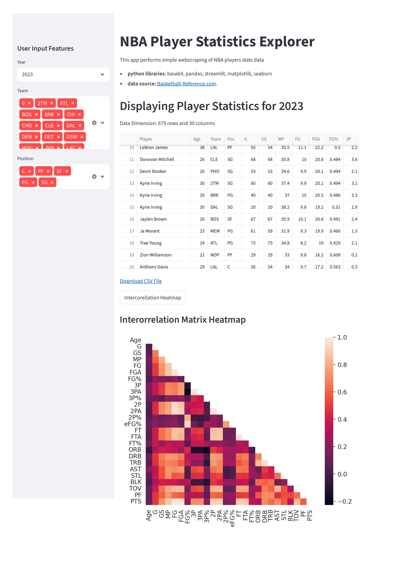

# Basketball Exploratory Data Analysis
Streamlit app with web scraping of NBA player stats data



## About the App

This interactive web application allows you to explore NBA player statistics from 2000 onwards. The app scrapes data from [Basketball-Reference.com](https://www.basketball-reference.com/) and provides an intuitive interface for filtering and analyzing player performance data.

### Features

- **Year Selection**: Choose any NBA season from 2000 to 2023
- **Team Filtering**: Select one or multiple teams to view their players' statistics
- **Position Filtering**: Filter players by position (C, PF, SF, PG, SG)
- **Interactive Data Display**: View filtered player statistics in a clean, sortable table
- **Data Export**: Download filtered data as CSV for further analysis
- **Correlation Analysis**: Generate an intercorrelation heatmap to visualize relationships between different statistical metrics

The app automatically caches data for improved performance and provides real-time feedback on the number of players and statistics displayed.

## How to Run

1. Install dependencies:
   ```
   pip install -r requirements.txt
   ```

2. Run the app:
   ```
   streamlit run basketball-app.py

